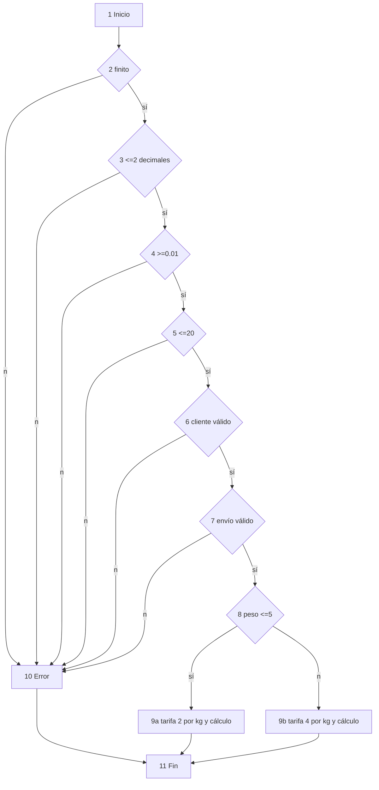
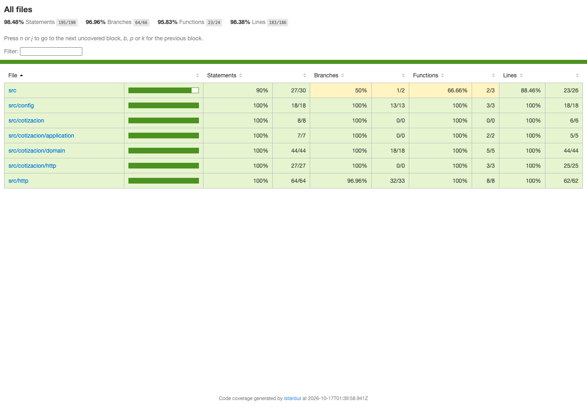

# Informe de QA — FastExpress

> **Curso:** Calidad de Software<br>
> **Proyecto:** FastExpress<br>
> **Fecha:** 17 de octubre de 2026<br>
> **Equipo:** Adolfo Andres Cera Urueta, Juan Esteban Ordoñez Tobon, Samuel David Morales Rios <br>
> **Repositorio:** https://github.com/Geriberto123/FastExpress.git

| Rol | Integrante |
| --- | --- |
| Desarrollador Backend | Adolfo Andres Cera Urueta|
| Desarrollador Frontend | Juan Esteban Ordoñez Tobon|
| Analista QA | Samuel David Morales Rios |

## 1. Introducción, alcance y objetivos

Se evaluó el cotizador contra BR-01 a BR-04: cálculo, validación, API, interfaz, cobertura y carga local. La ejecución final de la base `7b98b16` es Jest **177/177**, Node Test **3/3**, Playwright **11/11**, y benchmark local de 50 solicitudes correctas. Las salidas están en `docs/evidencias/`.

## 2. Stack y arquitectura de pruebas

Backend: NestJS 12, TypeScript, Jest/Supertest y decimal.js. Frontend: HTML/CSS/JS, Node Test y Playwright. La API se prueba con Nest configurado; Playwright combina rutas interceptadas para estados visuales y UI-08 contra backend real.

## 3. Supuestos, estrategia y criterios

- **Monto** no es entrada: es el total cotizado de salida; su BVA se deriva de los límites de peso.
- La tarifa del tramo se aplica a todo el peso. 5.00 kg da $15.00 y 5.01 kg $25.04: salto aproximado de $10 (exactamente $10.04), riesgo comercial conocido.
- Redondeo decimal half-up por importe: 0.03 kg/NUEVO/EXPRESS resulta subtotal $5.06, recargo $1.27 y total **$6.33**.
- `20.001` es formato inválido antes que exceso de límite en UI. Coma, punto y espacios externos son equivalentes; miles/mezclas, `5,`, `,`, `--5`, exponencial y >2 decimales son inválidos.
- Entrada: dependencias, compilación y oráculo disponibles. Salida: sin fallos, líneas y ramas >=85 %, evidencia guardada y defectos trazables.

### Cronograma y orden real de trabajo

El historial real está en `docs/evidencias/git-log.txt`. La implementación del backend fue registrada el 12 de octubre de 2026 (`1f40df3`), mientras que la primera matriz/suite explícita de caja negra fue registrada el 16 de octubre (`f5e0cb6` y `c57ec8f`). Por lo tanto, **la matriz de caja negra no fue escrita antes del código**; es una desviación del orden recomendado y se documenta sin alterar fechas. La interfaz inicial apareció el 5–12 de octubre y la consolidación QA/cobertura el 16 de octubre.

### Trazabilidad

| Alcance | IDs | Archivo de prueba/evidencia |
| --- | --- | --- |
| BR-01 tarifa base y BR-02 tramos | CP-101–108, CP-301–305 | `Backend/test/qa-blackbox.e2e.spec.ts` |
| BR-03 descuentos y BR-04 recargo | CP-201–207 | `Backend/test/qa-blackbox.e2e.spec.ts` |
| EP y BVA | CP-001–003, CP-101–112, CP-301–307, UI-02 | `Frontend/tests/unit/validators.test.cjs`, backend QA/unitarias |
| Decisión | CP-201–209 | `Backend/test/qa-blackbox.e2e.spec.ts` |
| Caja blanca | P1–P8 | `validar-entrada.spec.ts`, `calculador-tarifa.spec.ts` |
| Funcional/API | CP-101–305 | `Backend/test/*.e2e.spec.ts` |
| Interfaz | UI-01–09 | `Frontend/tests/ui/cotizador.spec.cjs` |
| Rendimiento | PF-001 | `tests/performance/cotizacion-local.mjs` |
| Cobertura | — | `docs/evidencias/coverage/coverage-summary.json` |

## 4. Caja negra: EP, BVA y decisión

| Clase EP de peso | Ejemplos | Esperado | IDs |
| --- | --- | --- | --- |
| Vacío | `''` | “El peso es obligatorio.” | UI-02 |
| No numérico/formato inválido | `abc`, `5kg`, `1e3`, `5,` | formato inválido | CP-002 |
| <= 0 | `0`, `0.00` | mínimo 0.01 kg | CP-109 |
| 0.01–5.00 | `0.01`, `4.99`, `5.00` | tramo $2/kg | CP-101–104 |
| 5.01–20.00 | `5.01`, `5.02`, `19.99`, `20.00` | tramo $4/kg | CP-105–108 |
| >20 | `20.01` | límite máximo 20 kg | CP-110 |
| Formato inválido | `20.001`, `0.001`, `5,`, `,`, `--5`, `-1` en UI | formato inválido | CP-002, CP-003, CP-111–112 |

| Entrada | Esperado en UI | Total NUEVO/ESTANDAR | ID |
| --- | --- | ---: | --- |
| 0.00 | mínimo | — | CP-109 |
| 0.01 | resultado | 5.02 | CP-101 |
| 0.02 | resultado | 5.04 | CP-102 |
| 4.99 | resultado | 14.98 | CP-103 |
| 5.00 | resultado | 15.00 | CP-104 |
| 5.01 | resultado | 25.04 | CP-105 |
| 5.02 | resultado | 25.08 | CP-106 |
| 19.99 | resultado | 84.96 | CP-107 |
| 20.00 | resultado | 85.00 | CP-108 |
| 20.01 | límite excedido | — | CP-110 |
| 20.001 | formato inválido | — | CP-003, CP-111 |
| 0.001 | formato inválido | — | CP-002, CP-112 |

No existe campo monto. La BVA de monto se cubre por 5.00/5.01/20.00 (CP-104, CP-105, CP-108): $15.00, $25.04 y $85.00.

Monto se define como **total cotizado**. La partición alcanzable observada va de $4.02 a $106.25. Los valores $4.01 y $106.26 no son alcanzables con entradas válidas: CP-306 y CP-307 lo demuestran exhaustivamente para pesos de 0.01 a 20.00 y todas las combinaciones permitidas.

| BVA monto total | Datos de entrada | Total esperado | ID |
| --- | --- | ---: | --- |
| Mínimo alcanzable | VIP, 0.01 kg, ESTANDAR | 4.02 | CP-301 |
| Vecino superior | VIP, 0.02 kg, ESTANDAR | 4.03 | CP-302 |
| Referencia NUEVO | NUEVO, 0.01 kg, ESTANDAR | 5.02 | CP-303 |
| Máximo ESTANDAR | NUEVO, 20.00 kg, ESTANDAR | 85.00 | CP-304 |
| Máximo alcanzable | NUEVO, 20.00 kg, EXPRESS | 106.25 | CP-305 |
| No alcanzable inferior | entradas válidas | 4.01 no aparece | CP-306 |
| No alcanzable superior | entradas válidas | 106.26 no aparece | CP-307 |

| Cliente | Envío | Descuento | Recargo | Total 2.00 kg | ID |
| --- | --- | ---: | ---: | ---: | --- |
| NUEVO | ESTANDAR | 0.00 | 0.00 | 9.00 | CP-201 |
| NUEVO | EXPRESS | 0.00 | 2.25 | 11.25 | CP-202 |
| FRECUENTE | ESTANDAR | 0.90 | 0.00 | 8.10 | CP-203 |
| FRECUENTE | EXPRESS | 0.90 | 2.25 | **10.35** | CP-204 |
| VIP | ESTANDAR | 1.80 | 0.00 | 7.20 | CP-205 |
| VIP | EXPRESS | 1.80 | 2.25 | **9.45** | CP-206 |
| INVÁLIDO | ESTANDAR | — | — | HTTP 400, cliente no válido | CP-208 |
| NUEVO | INVÁLIDO | — | — | HTTP 400, envío no válido | CP-209 |

CP-207 confirma 0.03/NUEVO/EXPRESS = **6.33**. CP-101–207 se ejecutan en `Backend/test/qa-blackbox.e2e.spec.ts`; CP-001–003 en `Frontend/tests/unit/validators.test.cjs`.

## 5. Caja blanca

El CFG incluye el flujo real de `CalculadorTarifaDecimal.calcular`, incluida `validarEntrada`; los errores convergen en un único Fin.



Este es un CFG **expandido**: combina `validarEntrada` (V(G)=7) y la decisión de tramo de `CalculadorTarifaDecimal.calcular` (V(G)=2); esos valores aislados no se suman. N=12 nodos (1–8, 9a, 9b, 10 y 11). E=18: 1 inicial + 12 de las seis validaciones + 2 del tramo + 2 de tarifa hacia Fin + 1 de Error hacia Fin. V(G)=E−N+2=18−12+2=**8**; también 7 decisiones+1. El PNG generado es `docs/evidencias/cfg.png` y su fuente Mermaid es `docs/evidencias/cfg.mmd`.

| Camino | Nodos | Entrada / esperado / obtenido | Prueba |
| --- | --- | --- | --- |
| P1 | 1-2-10-11 | NaN → error / error | unitaria `validarEntrada` |
| P2 | 1-2-3-10-11 | 0.001 → error de precisión / error | unitaria `validarEntrada` |
| P3 | 1-2-3-4-10-11 | 0 → mínimo / error | unitaria `validarEntrada` |
| P4 | 1-2-3-4-5-10-11 | 20.01 → máximo / error | unitaria `validarEntrada` |
| P5 | 1-…-6-10-11 | cliente inválido → error / error | unitaria `validarEntrada` |
| P6 | 1-…-7-10-11 | envío inválido → error / error | unitaria `validarEntrada` |
| P7 | 1-…-8-9a-11 | 5.00/NUEVO/ESTANDAR → 15.00 / 15.00 | unitaria `calculador-tarifa` |
| P8 | 1-…-8-9b-11 | 5.01/NUEVO/ESTANDAR → 25.04 / 25.04 | unitaria `calculador-tarifa` |

CP-207 (0.03 kg, NUEVO/EXPRESS → 6.33) es una prueba de datos sobre P7, no un camino independiente nuevo.

## 6. Unitarias, funcionales, interfaz y rendimiento

| Archivo | Prueba / regla | Fuente esperado | Evaluación |
| --- | --- | --- | --- |
| `calculador-tarifa.spec.ts` | BR-01–04, matriz, tramos, redondeo | fixtures con oráculo manual | Independiente del calculador; límites y combinaciones. |
| `validar-entrada.spec.ts` | mínimo, máximo, precisión, enums | requisitos | Clases inválidas del dominio. |
| `qa-blackbox.e2e.spec.ts` | CP-101–207, BR-01–04 | tablas de sección 4 | Añadido: API, BVA, decisión, half-up. |
| `cotizador.spec.cjs` | UI-01–09; UI-08a, UI-08b y UI-08c | requisitos UI | 11/11; UI-08a valida coma, UI-08b usa respuesta interceptada y UI-08c usa backend real. |
| `validators.test.cjs` | CP-001–003 | reglas/mensajes UI | 3/3. |

Jest agrupa unidad (dominio/HTTP/config), caja blanca (rutas de validación/cálculo), funcional (API) y caja negra (CP-001–307); su JSON enumera 177 casos. Playwright informa 11 UI y Node Test 3 CP. La trazabilidad concreta está en la tabla de la sección 3.

PF-001 (`tests/performance/cotizacion-local.mjs`) usa `fetch` y `Promise.all` sin dependencias: 50 concurrentes, 50 exitosas, 0 errores 5xx, p50 31.74 ms, p95 34.15 ms, total 65.38 ms. Criterio local: p95 <500 ms y 0 errores 5xx; cumple. Es benchmark local. k6/Locust no estaban instalados; se recomiendan en entorno desplegado.

## 7. Cobertura y análisis

`docs/evidencias/coverage/` contiene `coverage-summary.json` y HTML en `lcov-report/index.html`. Total: líneas **98.38 %**, ramas **96.96 %**, funciones **95.83 %**, sentencias **98.48 %**.

| Módulo | Líneas | Ramas | Funciones | Sentencias |
| --- | ---: | ---: | ---: | ---: |
| `src` | 88.46 | 50.00 | 66.66 | 90.00 |
| `src/config` | 100 | 100 | 100 | 100 |
| `src/cotizacion` | 100 | 100 | 100 | 100 |
| `src/cotizacion/application` | 100 | 100 | 100 | 100 |
| `src/cotizacion/domain` | 100 | 100 | 100 | 100 |
| `src/cotizacion/http` | 100 | 100 | 100 | 100 |
| `src/http` | 100 | 96.96 | 100 | 100 |

`src` agrupa `app.module.ts`, `health.controller.ts` y `main.ts`. Sus líneas/ramas/funciones no cubiertas corresponden al bloque de terminación de `main.ts` cuando arranca como proceso principal y a la rama de bootstrap; el reporte HTML lo muestra. El 96.96 % de ramas total coincide con `src/http` **por casualidad**: el total proviene de todos los archivos y `src/http` tiene una rama pendiente distinta, en `configurar-app.ts:35`, la alternativa de `error.constraints ?? {}` dentro de la fábrica de errores de validación. No corresponde a Swagger. No se excluyó Swagger. La captura de evidencia es `docs/evidencias/cobertura.png`.



## 8. Ciclo de defectos y observaciones

| ID | Estado | Registro y evidencia |
| --- | --- | --- |
| BUG-001 | Cerrado | **Módulo:** carga de recursos Frontend. **Pasos:** rama `repro/bug-001` desde `00e4ff2`, servir en modo sensible a mayúsculas y cargar la página. **Esperado:** ningún recurso 4xx/5xx. **Obtenido:** 404 en `/css/styles.css` y tres `/js/*.js`. **Severidad:** alta, porque la aplicación no carga estilo ni lógica en Linux sensible a mayúsculas. **Falla:** `docs/evidencias/bug-001-repro.txt`. **Verificación:** UI-09 verde en `frontend-ui.txt`. |
| OBS-002 | Pendiente producto | UI-03 afirma valor numérico `0.00`, no el signo. La presentación actual `-$0.00`/`+$0.00` es observación, no defecto confirmado. |
| OBS-001 | Cerrada | `git diff` confirma que solo cambiaron tipos/inferencia de `any`; ninguna expectativa ni aserción cambió. Lint y typecheck correctos. |

## 9. Conclusiones, riesgos y mejoras futuras

El proceso de QA de FastExpress concluye con evidencia de las reglas BR-01–04, las particiones y valores límite, la tabla de decisión, el redondeo half-up, la API, la interfaz UI-01–09, la cobertura y el benchmark local. La ejecución registrada cumple el umbral de cobertura establecido y no reporta fallos en las suites ejecutadas; por tanto, el alcance definido para esta entrega final queda verificado.

Para este informe, Monto se documenta y evalúa como el total cotizado de salida. Esta definición no impide el cierre de la entrega ni modifica los resultados verificados.

## 10. Cómo ejecutar

```sh
cd Backend && npm ci && npm test -- --coverage --coverageDirectory ../docs/evidencias/coverage
cd Backend && npm run lint && npm run typecheck
cd Frontend && npm ci && npx playwright install chromium
# test:ui inicia Backend automáticamente para UI-08 real
cd Frontend && npm run test:unit && npm run test:ui
cd Backend && npm run build && PORT=8001 npm start
# en otra terminal:
cd .. && FASTEXPRESS_URL=http://127.0.0.1:8001/api/cotizar CONCURRENCY=50 node tests/performance/cotizacion-local.mjs
# Si se instala Pandoc: pandoc docs/informe_qa.md -o docs/Informe_QA_FastExpress.docx
```
