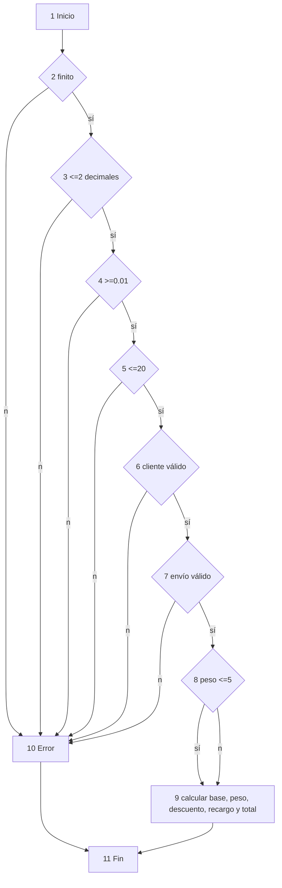

# Informe de QA — FastExpress

## 1. Introducción, alcance y objetivos

Se evaluó el cotizador contra BR-01 a BR-04: cálculo, validación, API, interfaz, cobertura y carga local. La ejecución final verificable es Jest **168/168**, Node Test **3/3**, Playwright **10/10**, y benchmark local de 50 solicitudes correctas. Las salidas están en `docs/evidencias/`.

## 2. Stack y arquitectura de pruebas

Backend: NestJS 12, TypeScript, Jest/Supertest y decimal.js. Frontend: HTML/CSS/JS, Node Test y Playwright. La API se prueba con Nest configurado; Playwright combina rutas interceptadas para estados visuales y UI-08 contra backend real.

## 3. Supuestos, estrategia y criterios

- **Monto** no es entrada: es el total cotizado de salida; su BVA se deriva de los límites de peso.
- La tarifa del tramo se aplica a todo el peso. 5.00 kg da $15.00 y 5.01 kg $25.04: salto aproximado de $10 (exactamente $10.04), riesgo comercial conocido.
- Redondeo decimal half-up por importe: 0.03 kg/NUEVO/EXPRESS resulta subtotal $5.06, recargo $1.27 y total **$6.33**.
- `20.001` es formato inválido antes que exceso de límite en UI. Coma, punto y espacios externos son equivalentes; miles/mezclas, `5,`, `,`, `--5`, exponencial y >2 decimales son inválidos.
- Entrada: dependencias, compilación y oráculo disponibles. Salida: sin fallos, líneas y ramas >=85 %, evidencia guardada y defectos trazables.

## 4. Caja negra: EP, BVA y decisión

| Clase EP de peso | Ejemplos | Esperado | IDs |
| --- | --- | --- | --- |
| Vacío | `''` | “El peso es obligatorio.” | CP-001 |
| No numérico | `abc`, `5kg`, `1e3` | formato inválido | CP-002 |
| <= 0 | `0`, `0.00`, `-1` | mínimo 0.01 kg | CP-109 |
| 0.01–5.00 | `0.01`, `4.99`, `5.00` | tramo $2/kg | CP-101–104 |
| 5.01–20.00 | `5.01`, `5.02`, `19.99`, `20.00` | tramo $4/kg | CP-105–108 |
| >20 | `20.01` | límite máximo 20 kg | CP-110 |
| Formato inválido | `20.001`, `0.001`, `5,`, `,`, `--5` | formato inválido | CP-002, CP-003, CP-111–112 |

| Entrada | Esperado en UI | Total NUEVO/ESTANDAR | ID |
| --- | --- | ---: | --- |
| 0.00 | mínimo | — | CP-109 |
| 0.01 | resultado | 5.02 | CP-101 |
| 0.02 | resultado | 5.04 | CP-102 |
| 4.99 | resultado | 14.98 | CP-103 |
| 5.00 | resultado | 15.00 | CP-104 |
| 5.01 | resultado | 25.04 | CP-105 |
| 5.02 | resultado | 25.08 | CP-106 |
| 19.99 | resultado | 84.96 | CP-107 |
| 20.00 | resultado | 85.00 | CP-108 |
| 20.01 | límite excedido | — | CP-110 |
| 20.001 | formato inválido | — | CP-003, CP-111 |
| 0.001 | formato inválido | — | CP-002, CP-112 |

No existe campo monto. La BVA de monto se cubre por 5.00/5.01/20.00 (CP-104, CP-105, CP-108): $15.00, $25.04 y $85.00.

| Cliente | Envío | Descuento | Recargo | Total 2.00 kg | ID |
| --- | --- | ---: | ---: | ---: | --- |
| NUEVO | ESTANDAR | 0.00 | 0.00 | 9.00 | CP-201 |
| NUEVO | EXPRESS | 0.00 | 2.25 | 11.25 | CP-202 |
| FRECUENTE | ESTANDAR | 0.90 | 0.00 | 8.10 | CP-203 |
| FRECUENTE | EXPRESS | 0.90 | 2.25 | **10.35** | CP-204 |
| VIP | ESTANDAR | 1.80 | 0.00 | 7.20 | CP-205 |
| VIP | EXPRESS | 1.80 | 2.25 | **9.45** | CP-206 |

CP-207 confirma 0.03/NUEVO/EXPRESS = **6.33**. CP-101–207 se ejecutan en `Backend/test/qa-blackbox.e2e.spec.ts`; CP-001–003 en `Frontend/tests/unit/validators.test.cjs`.

## 5. Caja blanca

El CFG incluye el flujo real de `CalculadorTarifaDecimal.calcular`, incluida `validarEntrada`; los errores convergen en un único Fin.



N=11. E=17: 1 inicial + 12 de seis validaciones + 2 de tramo + cálculo→Fin + Error→Fin. V(G)=E−N+2=17−11+2=**8**; también 7 decisiones+1. V(G)=7 solo describe `validarEntrada` aislada (seis decisiones); el cálculo completo agrega el tramo. No se fuerza un valor contrario al código real.

| Camino | Nodos | Entrada / esperado / obtenido | Prueba |
| --- | --- | --- | --- |
| P1 | 1-2-10-11 | NaN → error / error | validarEntrada no finito |
| P2 | 1-2-3-10-11 | 0.001 → error / error | CP-112 |
| P3 | 1-2-3-4-10-11 | 0 → error / error | CP-109 |
| P4 | 1-2-3-4-5-10-11 | 20.01 → error / error | CP-110 |
| P5 | 1-…-6-10-11 | cliente inválido → error / error | API inválidos |
| P6 | 1-…-7-10-11 | envío inválido → error / error | API inválidos |
| P7 | 1-…-8-9-11 | 5.00/NUEVO/ESTANDAR → 15.00 / 15.00 | CP-104 |
| P8 | 1-…-8-9-11 | 5.01/NUEVO/ESTANDAR → 25.04 / 25.04 | CP-105 |

## 6. Unitarias, funcionales, interfaz y rendimiento

| Archivo | Prueba / regla | Fuente esperado | Evaluación |
| --- | --- | --- | --- |
| `calculador-tarifa.spec.ts` | BR-01–04, matriz, tramos, redondeo | fixtures con oráculo manual | Independiente del calculador; límites y combinaciones. |
| `validar-entrada.spec.ts` | mínimo, máximo, precisión, enums | requisitos | Clases inválidas del dominio. |
| `qa-blackbox.e2e.spec.ts` | CP-101–207, BR-01–04 | tablas de sección 4 | Añadido: API, BVA, decisión, half-up. |
| `cotizador.spec.cjs` | UI-01–08 | requisitos UI | 10/10; UI-08 contra backend real. |
| `validators.test.cjs` | CP-001–003 | reglas/mensajes UI | 3/3. |

Jest agrupa unidad (dominio/HTTP/config), caja blanca (rutas de validación/cálculo), funcional (API) y caja negra (CP-001–207); su JSON enumera 168 casos. Playwright informa 10 UI y Node Test 3 CP.

PF-001 (`tests/performance/cotizacion-local.mjs`) usa `fetch` y `Promise.all` sin dependencias: 50 concurrentes, 50 exitosas, 0 errores 5xx, p50 31.74 ms, p95 34.15 ms, total 65.38 ms. Criterio local: p95 <500 ms y 0 errores 5xx; cumple. Es benchmark local. k6/Locust no estaban instalados; se recomiendan en entorno desplegado.

## 7. Cobertura y análisis

`docs/evidencias/coverage/` contiene `coverage-summary.json` y HTML en `lcov-report/index.html`. Total: líneas **98.38 %**, ramas **96.96 %**, funciones **95.83 %**, sentencias **98.48 %**.

| Módulo | Líneas | Ramas | Funciones | Sentencias |
| --- | ---: | ---: | ---: | ---: |
| `src` | 88.46 | 50.00 | 66.66 | 90.00 |
| `src/config` | 100 | 100 | 100 | 100 |
| `src/cotizacion` | 100 | 100 | 100 | 100 |
| `src/cotizacion/application` | 100 | 100 | 100 | 100 |
| `src/cotizacion/domain` | 100 | 100 | 100 | 100 |
| `src/cotizacion/http` | 100 | 100 | 100 | 100 |
| `src/http` | 100 | 96.96 | 100 | 100 |

No se excluyó Swagger. La rama pendiente es `configurar-app.ts:35`, configuración interna de Swagger; se informa, no se oculta.

## 8. Ciclo de defectos y observaciones

| ID | Estado | Registro y evidencia |
| --- | --- | --- |
| BUG-001 | Hallazgo corregido; reproducción histórica no demostrable | Rutas `css/js` frente a directorios `Css/Js` corregidas. No hay salida previa que capture el fallo en FS sensible a mayúsculas: no se afirma reproducción ni severidad basada en evidencia. UI final confirma carga, no fallo anterior. |
| OBS-002 | Pendiente producto | UI-03 afirma valor numérico `0.00`, no el signo. La presentación actual `-$0.00`/`+$0.00` es observación, no defecto confirmado. |
| OBS-001 | Cerrada | `git diff` confirma que solo cambiaron tipos/inferencia de `any`; ninguna expectativa ni aserción cambió. Lint y typecheck correctos. |

## 9. Conclusiones, riesgos y pendientes

Con evidencia se verificaron BR-01–04, BVA, decisión, half-up, validación, contrato, UI y benchmark local. Pendiente: decisión de producto sobre signo de cero y carga real con k6/Locust desplegado. El salto de tramo es riesgo comercial, no fallo de implementación.

## 10. Cómo ejecutar

```sh
cd Backend && npm ci && npm test -- --coverage --coverageDirectory ../docs/evidencias/coverage
cd Backend && npm run lint && npm run typecheck
cd Frontend && npm ci && npx playwright install chromium
# test:ui inicia Backend automáticamente para UI-08 real
cd Frontend && npm run test:unit && npm run test:ui
cd Backend && npm run build && PORT=8001 npm start
# en otra terminal:
cd .. && FASTEXPRESS_URL=http://127.0.0.1:8001/api/cotizar CONCURRENCY=50 node tests/performance/cotizacion-local.mjs
```
